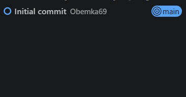
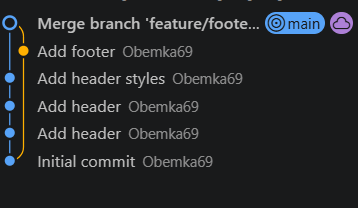

# Практика веток

## Задание 3.3

Достаточно посмотреть в левый нижний угол. Там и будет название ветки, на который ты находишься.

## Задание 4.3

1. Файлы находятся на отдельных ветках, поэтому в main их нету.
2. Файлы переместились в папку .git в зашифрованном формате в подпапке objects

## Задание 5.2

